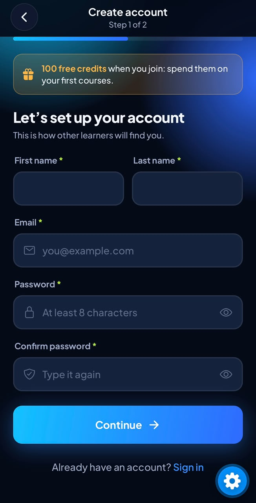
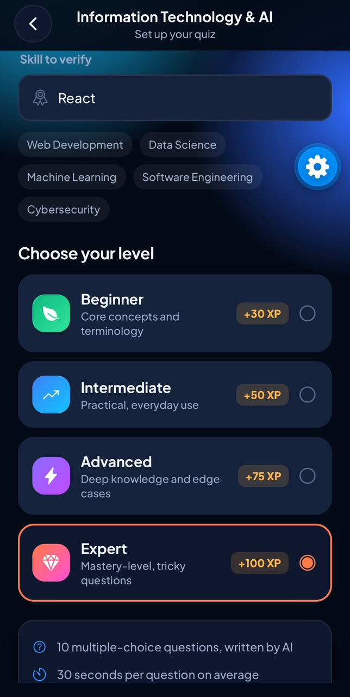
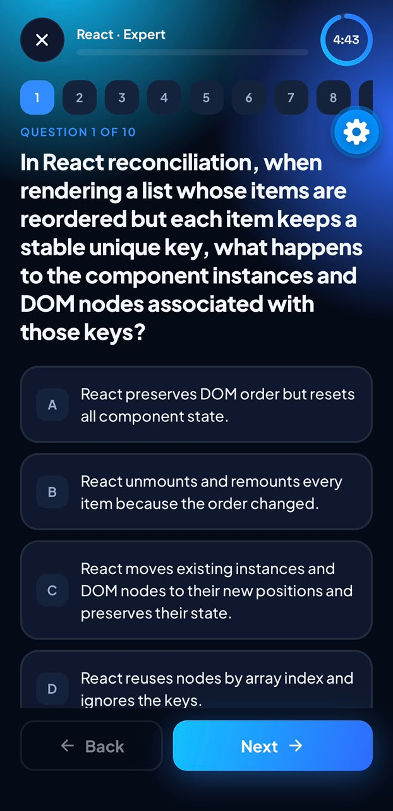
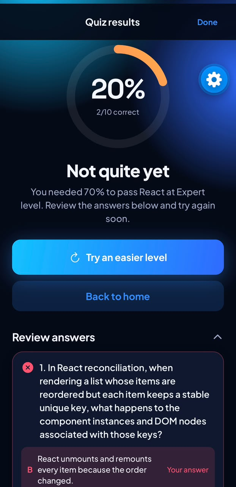
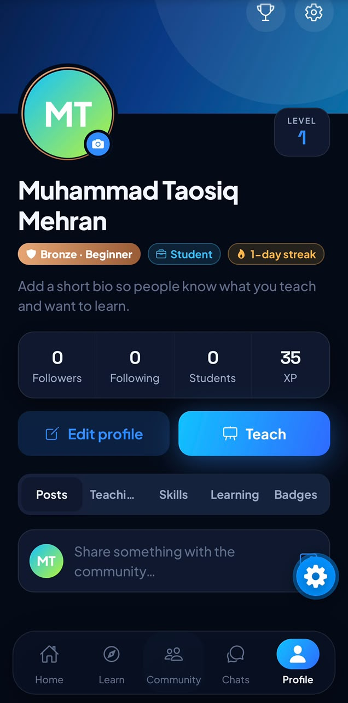
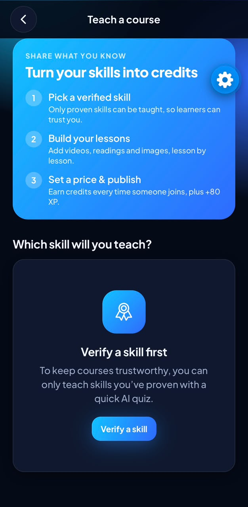

<p align="center">
  
</p>

<h1 align="center">P2PSkillX</h1>

<p align="center">
  <b>Learn from peers. Teach what you know. Level up together.</b><br/>
  A peer-to-peer skill exchange app for iOS and Android.
</p>

<p align="center">
  
  
  
  
</p>

---

## About

P2PSkillX lets people trade skills instead of money. Users prove a skill with an
AI-generated quiz, publish courses on the skills they've verified, and spend the
credits they earn to learn from others. Gamification keeps them coming back.

Final Year Project, NUST (2025).

## Screenshots

<table>
  <tr>
    <td align="center"><br/><sub>Sign up with 100 free credits</sub></td>
    <td align="center"><br/><sub>Pick a skill and a level</sub></td>
    <td align="center"><br/><sub>Timed AI-generated quiz</sub></td>
  </tr>
  <tr>
    <td align="center"><br/><sub>Graded on the server, with answer review</sub></td>
    <td align="center"><br/><sub>Profile with level, tier and streak</sub></td>
    <td align="center"><br/><sub>Teach only skills you've verified</sub></td>
  </tr>
</table>

## Features

- **AI skill verification:** timed multiple-choice quizzes at four levels, generated by AI and graded on the server.
- **Course marketplace:** create courses (priced in credits) on skills you've verified, enrol, track lesson progress and leave reviews. Instructors earn 80% of each enrolment.
- **Gamification:** XP, 50 levels, 6 tiers with credit rewards, daily streaks, daily quests, 15 achievements, a leaderboard, and colour themes unlocked by level.
- **Community:** posts, likes, comments, follows, one-to-one chat with unread counts, and notifications.
- **Personalised recommendations:** courses ranked by your skills, interests and the people you follow, each with a reason.
- **Light and dark mode** that follows the phone's setting, plus 5 colour themes.
- **Safety and privacy:** report and block on all user content, in-app account deletion, private personal data and a 13+ age gate.

## Tech stack

| Layer | Technology |
|---|---|
| Mobile app | React Native 0.88, Expo SDK 58, React Navigation 7, Reanimated 4 |
| Auth and database | Firebase Authentication, Cloud Firestore (with strict security rules) |
| Secure backend | Cloudflare Worker (quiz generation and grading, enrolment payments, XP and rewards) |
| AI | OpenRouter (free models), with curated question banks as a fallback |
| Testing | Jest (app), Node test runner (backend), Firestore emulator (security rules) |

## Architecture

```
 Mobile app (Expo)  ──── reads / writes allowed data ────►  Cloud Firestore
        │                                                       ▲
        │ Firebase ID token                                     │ admin access
        ▼                                                       │
 Cloudflare Worker  ──── quiz generation ────►  OpenRouter AI   │
  (trusted actions) ────────────────────────────────────────────┘
```

Anything involving trust runs on the server, where users can't tamper with it:
credits, XP, levels, verified skills and enrolments. The app never sees the AI key
or the quiz answers, and Firestore rules stop clients from editing these fields.

## Getting started

### Prerequisites
- [Node.js](https://nodejs.org) 20 or newer
- The **Expo Go** app on your phone ([iOS](https://apps.apple.com/app/expo-go/id982107779) · [Android](https://play.google.com/store/apps/details?id=host.exp.exponent))
- The Firebase web API key for the project (ask the project owner), or your own Firebase project

### Run the app
```bash
# 1. Clone and install
git clone https://github.com/taosiq/p2pskillx.git
cd p2pskillx
npm install

# 2. Add your keys (this file is git-ignored)
cp api-keys.template.js api-keys.js     # Windows: copy api-keys.template.js api-keys.js
```
Open `api-keys.js` and set `FIREBASE_API_KEY`. Leave `OPENROUTER_API_KEY` empty,
because the server handles AI.

```bash
# 3. Start
npx expo start -c
```
Scan the QR code with Expo Go (Android) or the Camera app (iOS). Your phone and
computer must be on the same Wi-Fi network.

**Troubleshooting**
- Phone can't connect, or it's stuck loading: run `npx expo start -c --tunnel` instead.
- "Unable to resolve module": make sure you're in the project root, not `backend/`.
- New accounts must verify their email before using the app (check the spam folder).

### Run the tests
Run each from the project root:
```bash
npm test                                          # app: gamification engine and helpers
cd backend && npm install && npm test             # backend: quiz sealing, question cleaning, Firestore encoding
cd firestore-tests && npm install && npm test     # security rules in the Firestore emulator (needs Java and firebase-tools)
```
The rules tests replay every write the app makes (sign-up, posts, follows, courses,
chat, notifications) and 70+ attacks: self-granted credits or XP, fake followers,
reading paid lessons, chat hijacking, spoofed notifications, and more.

### Backend and database
The backend address is set in `app.json` under `extra.apiUrl`. To deploy your own
Worker and the Firestore rules, follow [backend/README.md](backend/README.md).

## Project structure

```
├── App.js               Navigation and app start-up
├── screens/             All app screens
├── components/          Shared UI (design system, game widgets, social)
├── context/             Signed-in user, live profile, XP celebrations
├── services/            Firebase and backend calls
├── utils/               Gamification engine, recommendations, chat, helpers
├── theme/               Colour themes, light/dark mode, typography
├── backend/             Cloudflare Worker (secure API)
├── docs/screenshots/    README images
├── firestore.rules      Database security rules
├── firestore-tests/     Security rules tests (Firestore emulator)
└── __tests__/           App tests
```

## Security

- API keys and service accounts are never committed. `api-keys.js`, `.env` and `google-services.json` are git-ignored, and the server's secrets are stored in Cloudflare.
- Every backend request is verified with the user's Firebase ID token.
- Quiz answer keys are encrypted (AES-GCM) until the quiz is graded on the server.
- Personal details (email, date of birth, gender) are stored in a private document that only the owner can read.

## Author

**Muhammad Taosiq**, Final Year Project, NUST
